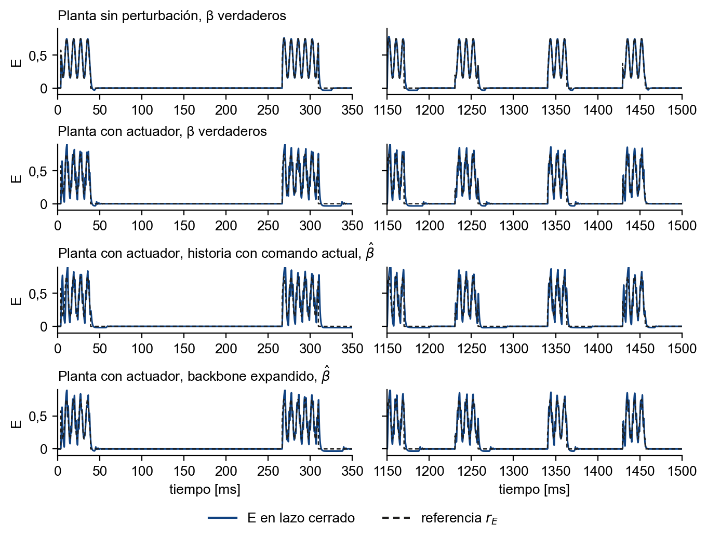
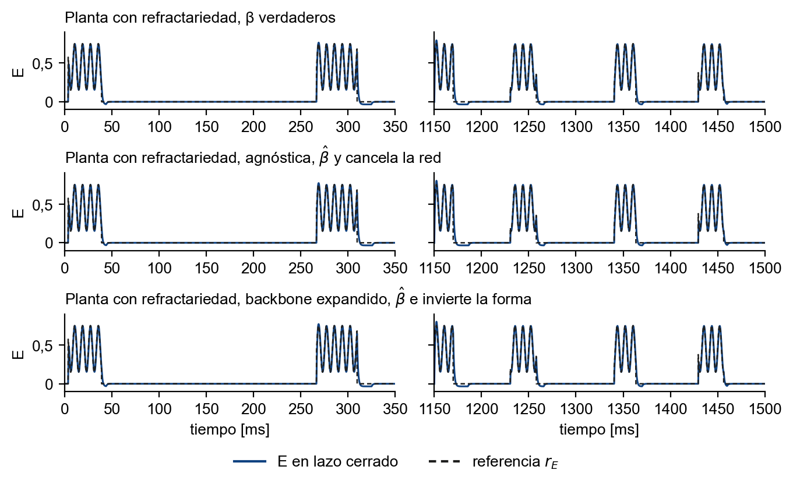

# Controlador de Martínez et al. (2022): pruebas sobre el simulador y los modelos gray-box

> **Prueba previa, no vigente.** En este documento el modelo identificado se usa dentro del controlador: sus $\hat\beta$ reemplazan a los parámetros del controlador, y el simulador hace de planta. Fue una prueba y no es la línea actual del proyecto. Lo vigente es el controlador del paper tal cual, con los parámetros del `.m`, y el modelo identificado conectado al controlador en lugar de la planta, al lado del simulador: `controlador_planta_modelo.pdf`.

El controlador se usa tal cual está en el paper: IMC con linealización por realimentación, sin cota sobre el comando y sin anti-windup. Entre filas cambia una sola cosa, los parámetros con los que se construye y, cuando el despeje cerrado lo admite, la corrección que cancela. La arquitectura de los modelos está en [[Arquitectura de los modelos gray-box]].

## 1. Controlador

La planta nominal es

$$\tau_e \dot E = -E + S_e(w_{EE}E - w_{EI}I + P), \qquad \tau_i \dot I = -I + S_i(w_{IE}E - w_{II}I + Q),$$

con $S_x(v) = 1/(1+e^{-a_x(v-\theta_x)}) - 1/(1+e^{a_x\theta_x})$. El controlador impone a cada población la dinámica lineal $\tau_x \dot x = -x + U_x$, con

$$U_x = k_{p,x}(r_x - x) + k_{i,x} Z_x, \qquad \dot Z_x = r_x - x .$$

Para eso pide a la sigmoidea la salida $U_x + k_x$, con $k_x = 1/(1+e^{a_x\theta_x})$, la invierte y resta el acoplamiento:

$$Q = \theta_i - \frac{1}{a_i}\ln\!\left(\frac{1}{U_I + k_i} - 1\right) - (w_{IE}E - w_{II}I),$$

y lo mismo para $P$ con los parámetros de E. Las ganancias son las del paper (ec. 12) y del código original, $k_p = \tau/\lambda$ y $k_i = 1/\lambda$ con $\lambda = 0{,}2$ ms: $k_{p,I} = 10$, $k_{i,I} = 5$, $k_{p,E} = 5$, $k_{i,E} = 5$. Quedan fijas en todas las pruebas. $U_x$ se recorta al dominio de la sigmoidea inversa, calculado siempre con los parámetros verdaderos para que todos los controladores tengan el mismo rango de actuación.

**Qué toma el controlador de cada modelo.** Todo modelo identificado tiene dos partes: los diez parámetros físicos $\hat\beta$ del backbone de Wilson-Cowan y una corrección para lo que el backbone no explica. La corrección depende del modelo:

- en el white-box no hay corrección;
- en la agnóstica y en la historia es una red neuronal ($\mathcal{N}_\phi(I, E)$ en la agnóstica; una red que además ve los últimos 5 ms del comando en la historia);
- en el backbone expandido son términos físicos agregados al backbone: el factor refractario o la copia del filtro del actuador.

La columna «uso» de las tablas indica qué partes entran al controlador:

- **solo $\hat\beta$.** Los $a_x$, $\theta_x$, $w$ y $k_x$ de las ecuaciones de arriba son los del modelo, en lugar de los verdaderos. La corrección se descarta aunque el modelo la tenga: en la agnóstica y en la historia, la red no interviene en el control.
- **$\hat\beta$ y cancela la red.** Además de los $\hat\beta$, el controlador usa la red agnóstica. Como $\mathcal{N}_\phi(I, E)$ no depende del comando, se resta del objetivo y la sigmoidea pasa a pedir $U_x + k_x - \tau_x\, \mathcal{N}_{\phi,x}(I, E)$.
- **$\hat\beta$ e invierte la forma.** El backbone expandido refractario tiene el factor $(1 - r_x x)$ sobre la sigmoidea y una saturación $\tanh(\alpha u)/\alpha$ en la entrada. El objetivo se divide por $(1 - \hat r_x x)$ y al final se invierte la saturación.

Las dos últimas solo existen en refractariedad. En el actuador, la red de la historia depende del comando y el backbone expandido agrega dos estados; en los dos casos el despeje del paper deja de ser cerrado, así que esos modelos se usan solo con sus $\hat\beta$.

**Simulación.** RK4 con paso de 0,005 ms; el controlador se recalcula en cada paso. Estado inicial $E = I = 0$ e integradores en cero. La medición no tiene ruido; el ruido está en los datos con que se identificó cada modelo.

## 2. Referencias y error

- **Gamma continua**, de 50 ms, la de las ecuaciones 13 y 14 del paper con $T_w = 1$, como en su figura 6: $r_E = 0{,}3\sin(2\pi\, 120\, t) + 0{,}45$ y $r_I = 0{,}2\sin(2\pi\, 120\, t - 0{,}94) + 0{,}25$, con $t$ en segundos.
- **Theta-gamma de 2 s**, la de la figura 7. Es la misma gamma, encendida solo cuando la fase de una theta está a menos de $\pi/4$ de su valle; fuera de esa ventana, $r_E = r_I = 0$. La theta es ruido blanco filtrado entre 4 y 12 Hz con semilla fija, para que no sea una senoidal pura.

El error que se reporta es el RMSE de seguimiento de cada población, sin el primer quinto de la simulación (10 ms en la gamma continua, 400 ms en la theta-gamma):

$$\mathrm{RMSE}_x = \sqrt{\frac{1}{N - n_0}\sum_{k=n_0}^{N-1}(x_k - r_{x,k})^2}, \qquad n_0 = N/5, \qquad \mathrm{RMSE} = \sqrt{\frac{\mathrm{RMSE}_E^2 + \mathrm{RMSE}_I^2}{2}} .$$

Las tablas dan ese RMSE combinado, en las mismas unidades de actividad que E e I. La columna «error de $\hat\beta$» es el error relativo medio de los diez parámetros físicos ($w_{EE}$, $w_{EI}$, $w_{IE}$, $w_{II}$, $\tau_e$, $\tau_i$, $a_e$, $a_i$, $\theta_e$, $\theta_i$) respecto de los verdaderos.

## 3. Casos

| caso | planta | parámetros del controlador |
|------------|--------------------|------------------------------------|
| ideal | Wilson-Cowan sin perturbación | verdaderos |
| β verdaderos | perturbada | verdaderos; no sabe de la perturbación |
| white-box | perturbada | $\hat\beta$ del white-box |
| con red | perturbada | $\hat\beta$ del mejor modelo con red por validación; la red se usa o no según la columna «uso» |
| backbone expandido | perturbada | $\hat\beta$ del backbone expandido |

Las perturbaciones son las del resto del trabajo: refractariedad con $r = 0{,}1$, y un actuador con filtro de primer orden ($\tau = 1$ ms) seguido de un recorte en ±3. Los modelos son los de la tanda `e25`, con datos de 2 s a 2 kHz y comandos bipolares de amplitud 1 a 12 (descripción en [[Arquitectura de los modelos gray-box]]), con $\sigma$ = 0,01 y 0,05 y tres semillas cada uno. Esos σ son el equivalente a 20 kHz; por muestra, el ruido de los datos a 2 kHz es de 0,0032 y 0,016. Las correcciones con red son las mismas que en `controlador_planta_modelo.pdf`:

- en refractariedad, la agnóstica con warm start y ventana de 5 ms;
- en el actuador, la historia con comando actual, con warm start.

En el backbone expandido, la refractariedad usa el factor $(1 - r x)$ y el actuador una copia del filtro y del recorte, los dos con warm start.

Son 90 simulaciones: 6 sin modelo identificado y 84 con modelo. Ninguna diverge.

## 4. Resultados

Ideal: RMSE de 0,0382 en la theta-gamma (E 0,0426, I 0,0331) y de 0,0324 en la gamma continua (E 0,0313, I 0,0335). Con modelo, los valores son media ± desvío sobre tres semillas.

**Planta con refractariedad**

| modelo | uso | σ | error de $\hat\beta$ | RMSE theta-gamma | RMSE gamma continua |
|----------------|--------------------|------|----------|--------------------|--------------------|
| ideal | | | 0 % | 0,0382 | 0,0324 |
| β verdaderos | | | 0 % | 0,0386 | 0,0339 |
| white-box | solo $\hat\beta$ | 0,01 | 8,8 % | 0,0386 ± 0,0000 | 0,0324 ± 0,0000 |
| | | 0,05 | 8,9 % | 0,0386 ± 0,0000 | 0,0323 ± 0,0000 |
| agnóstica (red) | solo $\hat\beta$ | 0,01 | 1,7 % | 0,0386 ± 0,0000 | 0,0340 ± 0,0000 |
| | | 0,05 | 2,0 % | 0,0386 ± 0,0000 | 0,0339 ± 0,0000 |
| agnóstica (red) | $\hat\beta$ y cancela la red | 0,01 | 1,7 % | 0,0392 ± 0,0000 | 0,0336 ± 0,0000 |
| | | 0,05 | 2,0 % | 0,0392 ± 0,0000 | 0,0338 ± 0,0001 |
| backbone expandido | $\hat\beta$ e invierte la forma | 0,01 | 0,2 % | 0,0384 ± 0,0000 | 0,0324 ± 0,0000 |
| | | 0,05 | 0,5 % | 0,0384 ± 0,0000 | 0,0324 ± 0,0000 |

**Planta con actuador**

| modelo | uso | σ | error de $\hat\beta$ | RMSE theta-gamma | RMSE gamma continua |
|----------------|--------------------|------|----------|--------------------|--------------------|
| ideal | | | 0 % | 0,0382 | 0,0324 |
| β verdaderos | | | 0 % | 0,0570 | 0,0676 |
| white-box | solo $\hat\beta$ | 0,01 | 121,9 % | 0,0738 ± 0,0001 | 0,0961 ± 0,0000 |
| | | 0,05 | 121,2 % | 0,0726 ± 0,0001 | 0,0959 ± 0,0001 |
| historia con comando actual (red) | solo $\hat\beta$ | 0,01 | 117,9 % | 0,0798 ± 0,0046 | 0,0784 ± 0,0165 |
| | | 0,05 | 114,4 % | 0,0828 ± 0,0051 | 0,0730 ± 0,0059 |
| backbone expandido | solo $\hat\beta$ | 0,01 | 0,1 % | 0,0583 ± 0,0000 | 0,0665 ± 0,0012 |
| | | 0,05 | 0,7 % | 0,0584 ± 0,0020 | 0,0619 ± 0,0065 |

{width=85%}

*Figura 1.* Actividad excitatoria en lazo cerrado (azul) y referencia $r_E$ (negro, discontinua) en la theta-gamma de 2 s. Izquierda, de 0 a 350 ms; derecha, de 1150 a 1500 ms. Controlador de Martínez et al. (2022) sin cota ni anti-windup. Fila 1: planta sin perturbación con parámetros verdaderos. Filas 2 a 4: planta con actuador (filtro de 1 ms y recorte en ±3) con parámetros verdaderos, con los $\hat\beta$ de la historia con comando actual y con los $\hat\beta$ del backbone expandido, los dos con warm start. Modelos con $\sigma$ = 0,01, semilla 0.

{width=85%}

*Figura 2.* Igual que la figura 1, para la planta con refractariedad ($r = 0{,}1$). Filas: parámetros verdaderos; $\hat\beta$ de la agnóstica cancelando la red; $\hat\beta$ del backbone expandido con la inversión del factor $(1 - r x)$ y de la saturación.

## 5. Observaciones

**Refractariedad.** La perturbación casi no degrada al controlador: con parámetros verdaderos el RMSE sube de 0,0382 a 0,0386 en la theta-gamma y de 0,0324 a 0,0339 en la gamma continua. Los modelos quedan cerca de ese caso: entre 0,0384 y 0,0392 en la theta-gamma (−0,5 a +1,6 %) y entre 0,0323 y 0,0340 en la gamma continua (−4,7 a +0,3 %). En la gamma continua, el backbone expandido con su inversión y el white-box quedan en el nivel ideal (0,0324). Cancelar la red mejora la gamma continua respecto de usar solo $\hat\beta$ y empeora la theta-gamma en un 1,6 %.

**Actuador.** Es la perturbación que importa para el control. Con parámetros verdaderos, el RMSE sube un 49 % en la theta-gamma (0,0382 a 0,0570) y se duplica en la gamma continua (0,0324 a 0,0676). La figura 1 muestra el origen: el filtro de 1 ms atrasa el comando y la oscilación sale deformada, con picos secundarios.

- El backbone expandido identifica $\hat\beta$ con 0,1 a 0,7 % de error y controla como el controlador con β verdaderos: +2 % en la theta-gamma y de −8 a −2 % en la gamma continua, con desvío entre semillas de hasta 0,0065 en σ = 0,05.
- El white-box y la historia compensan el recorte deformando $\hat\beta$ (114 a 122 % de error), y usados así empeoran el control: +27 a +29 % (white-box) y +40 a +45 % (historia) en la theta-gamma, +42 % y +8 a +16 % en la gamma continua.

La dispersión entre semillas de la historia (hasta 0,0165) es del mismo orden que las diferencias entre modelos.

**Comando.** Sin cota, el controlador pide comandos fuera de ±3, el nivel del recorte. Con la planta ideal, $P$ va de −12,9 a +12,4 en la theta-gamma; en el actuador, con β verdaderos o con los $\hat\beta$ del backbone expandido, de −14 a +13. Con los $\hat\beta$ deformados el comando crece: hasta +21 con el white-box y +38 con la historia. Los datos de entrenamiento cubren $|P| \le 12$, así que solo los dos últimos casos salen de ese rango. Esto también ocurre en el paper: su saturación acota $\tilde u_x$ a $[-k_x, 1 - k_x]$ para que exista la sigmoidea inversa, pero no acota $P$ ni $Q$. Su figura 8d muestra $P$ entre −15 y +8 en la misma tarea.

**Limitaciones de esta prueba.** El controlador del paper solo aprovecha de un modelo con red lo que entra en su despeje cerrado: los $\hat\beta$ y, en refractariedad, una red que depende solo del estado. Las variantes que invierten la red o el backbone expandido con actuador, y las versiones con cota y anti-windup, están en [[Controladores - resultados]]. La medición es sin ruido y el controlador recibe $E$ e $I$ directamente; en el paper los estima un filtro de Kalman extendido a partir del LFP con ruido. Fuera de eso, la estructura es la misma: ganancias, saturación de $\tilde u_x$, inversión de la sigmoidea y cancelación del acoplamiento.
