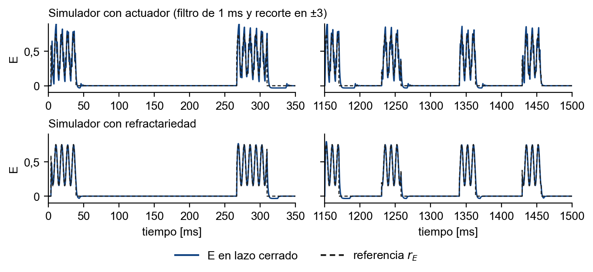
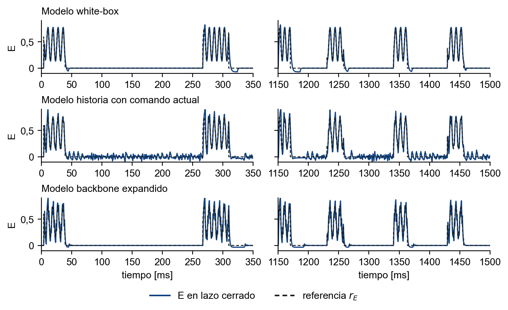
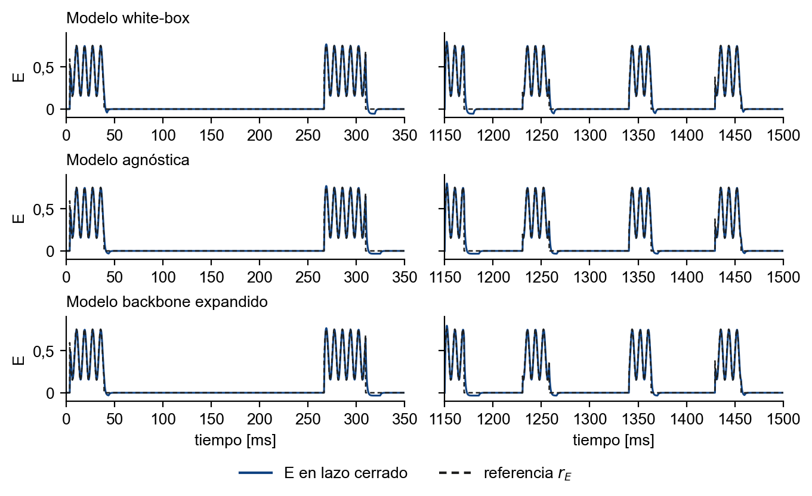

---
header-includes:
  - \usepackage{tikz}
  - \usetikzlibrary{arrows.meta,positioning,calc}
---

# Controlador IMC: resultados sobre el simulador y sobre los modelos gray-box

## 1. Controlador

Planta nominal:

$$\tau_e \dot E = -E + S_e(w_{EE}E - w_{EI}I + P), \qquad \tau_i \dot I = -I + S_i(w_{IE}E - w_{II}I + Q),$$

con $S_x(v) = 1/(1+e^{-a_x(v-\theta_x)}) - k_x$ y $k_x = 1/(1+e^{a_x\theta_x})$.

Ley de control, por población:

$$\dot Z_x = r_x - x, \qquad U_x = k_{p,x}(r_x - x) + k_{i,x} Z_x, \qquad k_{p,I} = 10,\ k_{i,I} = 5,\ k_{p,E} = 5,\ k_{i,E} = 5.$$

$U_x$ se recorta a $[f_{x,m}, f_{x,M}]$, con $f_{x,m} = 0{,}99999\,(1/(1+e^{-a_x(-100-\theta_x)}) - k_x)$ y $f_{x,M}$ igual con $+100$. Después se invierte la sigmoidea y se resta el acoplamiento:

$$Q = \theta_i - \frac{1}{a_i}\ln\!\left(\frac{1}{U_I + k_i} - 1\right) - (w_{IE}E - w_{II}I), \qquad P = \theta_e - \frac{1}{a_e}\ln\!\left(\frac{1}{U_E + k_e} - 1\right) - (w_{EE}E - w_{EI}I).$$

Los parámetros del controlador son siempre los del `.m`: $\tau_e = 1$, $\tau_i = 2$, $w_{EE} = 6{,}4$, $w_{EI} = 4{,}8$, $w_{IE} = 6$, $w_{II} = 1{,}2$, $a_e = 1{,}2$, $a_i = 1$, $\theta_e = 2{,}8$, $\theta_i = 4$. Sobre la planta nominal, el lazo cerrado queda $\tau_x \dot x = -x + U_x$. No hay cota sobre $P$ ni $Q$, ni anti-windup. Tiempo en ms.

## 2. Del archivo de MATLAB a Python

**Original.** `simulador_wilson_cowan_con_control.m` define una sola función, `msd_ode`, con estado $[Z_1, Z_2, I, E]$. La ley de control está escrita adentro de las ecuaciones de la planta, y los parámetros de los dos son las mismas variables. Se integra con `ode45` (RelTol $10^{-3}$, AbsTol $10^{-6}$) durante 50 ms. Las referencias se generan en una grilla de 10 000 puntos y se interpolan con `interp1`.

**Port.** `IMCController`, en `src/neural_ode/closed_loop.py`, conserva la ley, las ganancias, los límites de recorte y las referencias. Cambia la organización:

- **Controlador y planta separados.** `IMCController.compute(Z1, Z2, I, E, rI, rE)` devuelve $(P, Q, \dot Z_1, \dot Z_2)$. La planta es una función aparte, $(I, E, P, Q, \text{estados internos}, t) \to (\dot I, \dot E, \text{derivadas de los estados internos})$. Así la misma ley se conecta al simulador o a un modelo sin tocar el controlador.
- **Parámetros como argumentos.** `fixed` ($\tau$, $a$, $\theta$, $k$) y `weights` ($w$) se pasan al construirlo, en vez de ser variables compartidas con la planta.
- **Integración.** `simulate_closed_loop_ext` (`src/neural_ode/closed_loop_ext.py`) integra $[Z_1, Z_2, I, E, \text{estados internos de la planta}]$ con RK4 de paso fijo, $\Delta t = 0{,}005$ ms. El comando se calcula al principio de cada paso y se mantiene durante el paso. Las referencias se evalúan en forma analítica, sin interpolar.

**Verificación.** Las ecuaciones de `msd_ode` se integraron en Python con RK45 de Dormand-Prince, el método de `ode45`, y se compararon con el port sobre la planta sin perturbación y la gamma continua de 50 ms:

| integración | RMSE de seguimiento |
|---|---|
| ecuaciones del `.m`, RK45 con las tolerancias del `.m` | 0,03228 |
| ecuaciones del `.m`, RK45 con tolerancias $10^{-10}$ y $10^{-12}$ | 0,03243 |
| port, RK4 con $\Delta t$ = 0,005 ms | 0,03244 |

Diferencia máxima entre el port y la solución fina del `.m`:

| $\Delta t$ del port | $\max\lvert\Delta I\rvert$ | $\max\lvert\Delta E\rvert$ |
|---|---|---|
| 0,005 ms | $4{,}1 \times 10^{-4}$ | $1{,}3 \times 10^{-4}$ |
| 0,0025 ms | $2{,}0 \times 10^{-4}$ | $6{,}3 \times 10^{-5}$ |
| 0,00125 ms | $1{,}0 \times 10^{-4}$ | $3{,}1 \times 10^{-5}$ |

La diferencia es proporcional a $\Delta t$, que es lo que da mantener el comando constante durante el paso.

## 3. Conexión con los modelos

El controlador es el mismo en todas las simulaciones. Cambia lo que se le conecta: la planta, que es el simulador perturbado, o en su lugar un modelo identificado a partir de los datos de ese simulador.

```{=latex}
\begin{center}
\begin{tikzpicture}[font=\small,
  caja/.style={draw, rounded corners=2pt, align=center, inner sep=5pt,
               minimum height=15mm, minimum width=30mm},
  flecha/.style={-{Stealth[length=2.2mm]}, semithick}]
\node[caja] (sim) at (8.6,0)  {simulador perturbado\\\texttt{make\_perturbed\_plant}};
\node[caja] (mod) at (13.4,0) {modelo identificado\\\texttt{planta\_de(modelo)}};
\node[caja] (r)   at (0,-2.8)   {referencias\\$r_I(t)$, $r_E(t)$};
\node[caja] (c)   at (4.2,-2.8) {controlador\\\texttt{IMCController}\\parámetros del \texttt{.m}};
\node[caja, minimum width=70mm] (pl) at (11.2,-2.8) {planta o modelo\\$(I, E, P, Q) \to (\dot I, \dot E)$};
\draw[flecha] (sim.south) -- (sim.south |- pl.north);
\draw[flecha] (mod.south) -- (mod.south |- pl.north);
\node at ($(sim.east)!0.5!(mod.west)$) {o};
\draw[flecha] (r) -- (c);
\draw[flecha] (c) -- node[above] {$P$, $Q$} (pl);
\draw[flecha] (pl.south) -- ++(0,-0.7) -| node[pos=0.25, below] {$I$, $E$} (c.south);
\end{tikzpicture}
\end{center}
```

Pasos, como en `scripts/control_paper_planta_modelo.py`:

1. `cargar(ruta)` (`scripts/esc_eval.py`) reconstruye el modelo desde su checkpoint.
2. `planta_de(modelo)` lo prepara para conectarlo al controlador en lugar de la planta. El campo $\hat f(I, E, P, Q)$ se reescribe en numpy con los pesos del checkpoint: con PyTorch, una simulación de 2 s son 1,6 millones de evaluaciones y tarda más de diez minutos. En 200 puntos al azar, la diferencia con el `forward` de PyTorch es menor que $2{,}2 \times 10^{-7}$ relativo, en los 36 modelos. Según el modelo:
    - **white-box, agnóstica y backbone expandido refractario.** El campo, sin estados internos.
    - **historia con comando actual.** El modelo guarda el comando que recibe en cada paso y le pasa a la red $P$ y $Q$ en $t, t - 0{,}5, \dots, t - 4{,}5$ ms (10 valores, al paso de los datos de entrenamiento). Antes de $t = 0$ el comando vale 0.
    - **backbone expandido con actuador.** Dos estados internos, $\hat P$ y $\hat Q$, con $\dot{\hat P} = (P - \hat P)/\hat\tau$, y el campo recibe $\hat P$ recortado en $\pm 1/\hat\alpha$; lo mismo para $Q$. Arrancan en 0.
3. `IMCController(fixed_de(β del .m), w del .m)` construye el controlador.
4. `simulate_closed_loop_ext(planta, controlador, referencias, dt=0.005, dt_ctrl=0.005)` corre el lazo. Para el simulador, la planta es `make_perturbed_plant(β del .m, perturbación)`.

## 4. Casos, referencias y métrica

**Simulador.** Wilson-Cowan con los parámetros del `.m`: sin perturbación; con refractariedad, la sigmoidea multiplicada por $(1 - r x)$, $r = 0{,}1$; con actuador, filtro de primer orden de 1 ms seguido de un recorte en ±3.

**Modelos.** Tanda `e25`, identificados con datos de 2 s a 2 kHz del simulador con cada perturbación, con comandos bipolares de amplitud 1 a 12 (descripción en `arquitectura_modelos.pdf`). σ = 0,01 y 0,05 (equivalentes a 20 kHz; por muestra, 0,0032 y 0,016), semillas 0, 1 y 2:

| fila | refractariedad | actuador |
|---|---|---|
| white-box | `e1wb` | `e2wb` |
| agnóstica / historia | agnóstica con warm start, ventana de 5 ms | historia con comando actual, con warm start |
| backbone expandido | factor $(1 - r x)$ y saturación, con warm start | copia del filtro y recorte, con warm start |

Son los mismos modelos de la sección de lazo cerrado del informe (`scripts/control_amplitud.py`, `results/control_amplitud.json`).

**Referencias.**

- Gamma continua (50 ms): $r_E = 0{,}3\sin(2\pi\, 120\, t) + 0{,}45$, $r_I = 0{,}2\sin(2\pi\, 120\, t - 0{,}94) + 0{,}25$, $t$ en s.
- Theta-gamma de 2 s (`theta_gamma_ventana_refs`): la misma gamma mientras la fase de una theta está a menos de $\pi/4$ de su valle, y $r_E = r_I = 0$ fuera. La theta es ruido blanco filtrado entre 4 y 12 Hz, con semilla fija.

**Simulación.** Estado inicial e integradores en cero. Medición de $I$ y $E$ sin ruido.

**Error.**

$$\mathrm{RMSE}_x = \sqrt{\frac{1}{N - n_0}\sum_{k=n_0}^{N-1}(x_k - r_{x,k})^2}, \qquad n_0 = N/5, \qquad \mathrm{RMSE} = \sqrt{\frac{\mathrm{RMSE}_E^2 + \mathrm{RMSE}_I^2}{2}} .$$

**Distancia al lazo con el simulador.** Con el mismo controlador y la misma referencia, se compara la simulación con el modelo conectado contra la simulación con el simulador, sobre el mismo último 80 %:

$$d = \sqrt{\frac{\overline{(E_m - E_s)^2} + \overline{(I_m - I_s)^2}}{2}} ,$$

con $m$ el lazo con el modelo y $s$ el lazo con el simulador. El RMSE de seguimiento del lazo con el modelo puede ser menor que el del simulador sin que el modelo sea mejor; la distancia mide cuánto se parecen los dos lazos.

Con el modelo conectado en lugar de la planta, media ± desvío sobre las tres semillas.

## 5. Resultados

Simulador sin perturbación: RMSE 0,0382 en la theta-gamma (E 0,0426, I 0,0331) y 0,0324 en la gamma continua (E 0,0313, I 0,0335). Todas las simulaciones terminan sin divergir.

**Refractariedad, theta-gamma**

| conectado al controlador | σ | RMSE de seguimiento | distancia al lazo con el simulador |
|---|---|---|---|
| simulador | | 0,0386 | |
| white-box | 0,01 | 0,0391 ± 0,0000 | 0,0068 ± 0,0000 |
|  | 0,05 | 0,0390 ± 0,0000 | 0,0068 ± 0,0000 |
| agnóstica | 0,01 | 0,0388 ± 0,0000 | 0,0007 ± 0,0000 |
|  | 0,05 | 0,0387 ± 0,0000 | 0,0007 ± 0,0000 |
| backbone expandido | 0,01 | 0,0385 ± 0,0000 | 0,0002 ± 0,0000 |
|  | 0,05 | 0,0385 ± 0,0000 | 0,0003 ± 0,0000 |

**Refractariedad, gamma continua**

| conectado al controlador | σ | RMSE de seguimiento | distancia al lazo con el simulador |
|---|---|---|---|
| simulador | | 0,0339 | |
| white-box | 0,01 | 0,0348 ± 0,0000 | 0,0026 ± 0,0000 |
|  | 0,05 | 0,0347 ± 0,0000 | 0,0027 ± 0,0000 |
| agnóstica | 0,01 | 0,0344 ± 0,0000 | 0,0011 ± 0,0000 |
|  | 0,05 | 0,0342 ± 0,0001 | 0,0008 ± 0,0001 |
| backbone expandido | 0,01 | 0,0337 ± 0,0000 | 0,0002 ± 0,0000 |
|  | 0,05 | 0,0337 ± 0,0000 | 0,0003 ± 0,0000 |

**Actuador con recorte, theta-gamma**

| conectado al controlador | σ | RMSE de seguimiento | distancia al lazo con el simulador |
|---|---|---|---|
| simulador | | 0,0570 | |
| white-box | 0,01 | 0,0535 ± 0,0000 | 0,0365 ± 0,0000 |
|  | 0,05 | 0,0534 ± 0,0000 | 0,0365 ± 0,0000 |
| historia con comando actual | 0,01 | 0,0613 ± 0,0006 | 0,0412 ± 0,0018 |
|  | 0,05 | 0,0643 ± 0,0038 | 0,0439 ± 0,0048 |
| backbone expandido | 0,01 | 0,0574 ± 0,0000 | 0,0123 ± 0,0001 |
|  | 0,05 | 0,0572 ± 0,0001 | 0,0131 ± 0,0003 |

**Actuador con recorte, gamma continua**

| conectado al controlador | σ | RMSE de seguimiento | distancia al lazo con el simulador |
|---|---|---|---|
| simulador | | 0,0676 | |
| white-box | 0,01 | 0,0563 ± 0,0000 | 0,0676 ± 0,0000 |
|  | 0,05 | 0,0558 ± 0,0000 | 0,0674 ± 0,0000 |
| historia con comando actual | 0,01 | 0,0594 ± 0,0017 | 0,0728 ± 0,0034 |
|  | 0,05 | 0,0571 ± 0,0027 | 0,0680 ± 0,0024 |
| backbone expandido | 0,01 | 0,0668 ± 0,0001 | 0,0085 ± 0,0003 |
|  | 0,05 | 0,0653 ± 0,0002 | 0,0141 ± 0,0011 |

**Rango del comando** (percentiles 5 y 95; mínimo del 5 y máximo del 95 sobre los dos σ y las tres semillas)

| perturbación | conectado al controlador | $P$, theta-gamma | $Q$, theta-gamma | $P$, gamma continua | $Q$, gamma continua |
|---|---|---|---|---|---|
| refractariedad | simulador | −9,5 a 1,5 | −12,4 a 0,6 | 0,9 a 1,5 | −13,2 a 0,8 |
|  | white-box | −9,2 a 1,5 | −12,4 a 0,8 | 0,8 a 1,6 | −13,1 a 0,9 |
|  | agnóstica | −9,5 a 1,4 | −12,4 a 0,6 | 0,9 a 1,5 | −13,3 a 0,8 |
|  | backbone expandido | −9,5 a 1,5 | −12,4 a 0,6 | 0,9 a 1,5 | −13,2 a 0,8 |
| actuador con recorte | simulador | −9,5 a 5,2 | −12,7 a 2,7 | −11,7 a 11,0 | −13,7 a 11,3 |
|  | white-box | −9,4 a 3,1 | −12,6 a 1,7 | −2,0 a 9,0 | −13,6 a 2,4 |
|  | historia con comando actual | −10,1 a 5,0 | −12,7 a 3,9 | −10,2 a 9,7 | −14,0 a 11,8 |
|  | backbone expandido | −9,5 a 5,1 | −12,7 a 2,7 | −11,8 a 10,9 | −13,7 a 11,3 |

{width=85%}

*Figura 1.* Actividad excitatoria $E$ (azul) y referencia $r_E$ (negro, discontinua) en el lazo con el simulador, theta-gamma de 2 s. Izquierda, de 0 a 350 ms; derecha, de 1150 a 1500 ms. Controlador IMC con los parámetros del `.m`, sin cota ni anti-windup. Fila 1: simulador con actuador (filtro de 1 ms y recorte en ±3). Fila 2: simulador con refractariedad ($r = 0{,}1$).

{width=85%}

*Figura 2.* Igual que la figura 1, con el modelo conectado al controlador en lugar del simulador con actuador. Filas: modelos white-box, historia con comando actual y backbone expandido, identificados de ese simulador con σ = 0,01, semilla 0.

{width=85%}

*Figura 3.* Igual que la figura 2, para el simulador con refractariedad. Filas: modelos white-box, agnóstica y backbone expandido.
