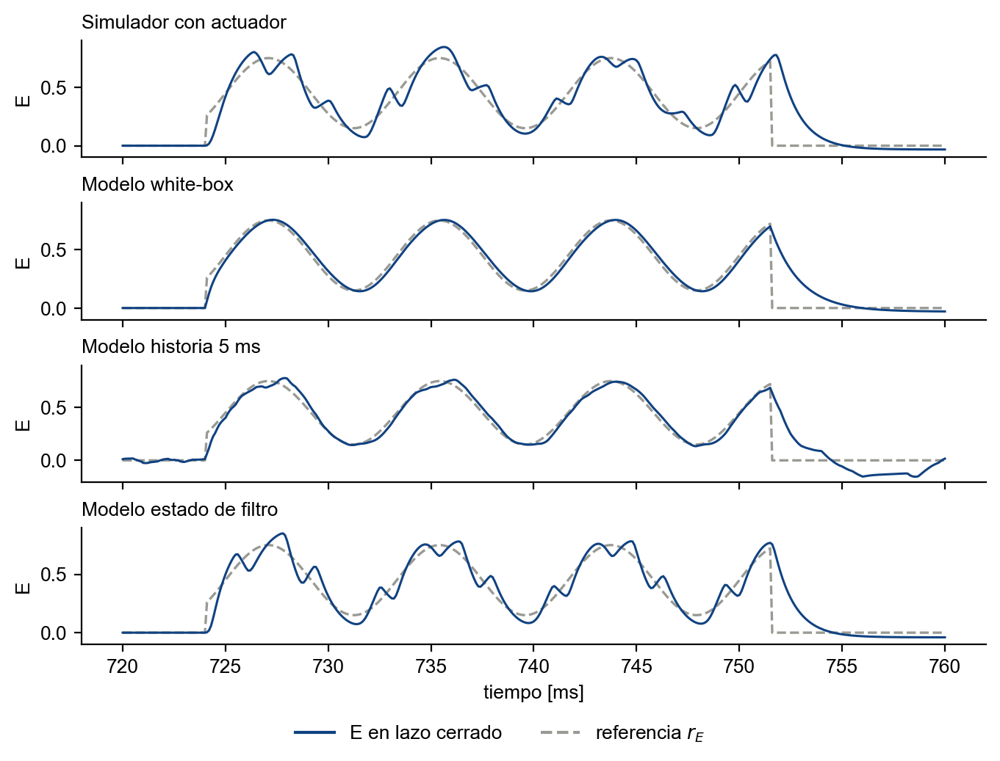
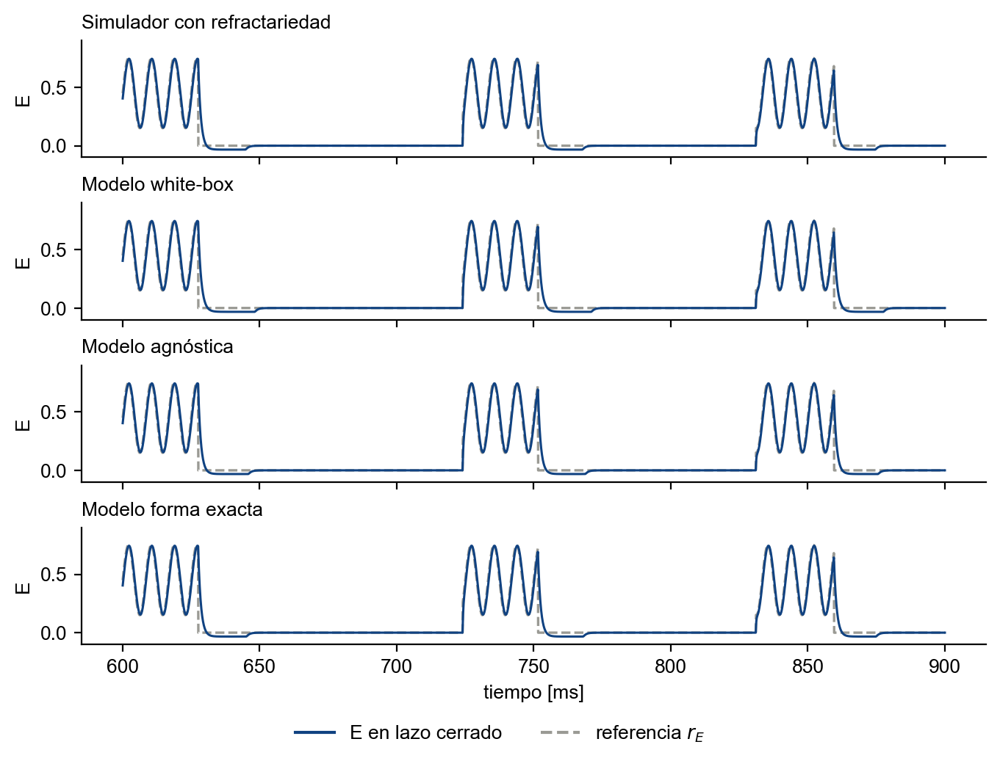

---
header-includes:
  - \usepackage{tikz}
  - \usetikzlibrary{arrows.meta,positioning,calc}
---

# Controlador IMC: resultados sobre el simulador y sobre los modelos gray-box

## 1. Controlador

Planta nominal:

$$\tau_e \dot E = -E + S_e(w_{EE}E - w_{EI}I + P), \qquad \tau_i \dot I = -I + S_i(w_{IE}E - w_{II}I + Q),$$

con $S_x(v) = 1/(1+e^{-a_x(v-\theta_x)}) - k_x$ y $k_x = 1/(1+e^{a_x\theta_x})$.

Ley de control, por población:

$$\dot Z_x = r_x - x, \qquad U_x = k_{p,x}(r_x - x) + k_{i,x} Z_x, \qquad k_{p,I} = 10,\ k_{i,I} = 5,\ k_{p,E} = 5,\ k_{i,E} = 5.$$

$U_x$ se recorta a $[f_{x,m}, f_{x,M}]$, con $f_{x,m} = 0{,}99999\,(1/(1+e^{-a_x(-100-\theta_x)}) - k_x)$ y $f_{x,M}$ igual con $+100$. Después se invierte la sigmoidea y se resta el acoplamiento:

$$Q = \theta_i - \frac{1}{a_i}\ln\!\left(\frac{1}{U_I + k_i} - 1\right) - (w_{IE}E - w_{II}I), \qquad P = \theta_e - \frac{1}{a_e}\ln\!\left(\frac{1}{U_E + k_e} - 1\right) - (w_{EE}E - w_{EI}I).$$

Los parámetros del controlador son siempre los del `.m`: $\tau_e = 1$, $\tau_i = 2$, $w_{EE} = 6{,}4$, $w_{EI} = 4{,}8$, $w_{IE} = 6$, $w_{II} = 1{,}2$, $a_e = 1{,}2$, $a_i = 1$, $\theta_e = 2{,}8$, $\theta_i = 4$. Sobre la planta nominal, el lazo cerrado queda $\tau_x \dot x = -x + U_x$. No hay cota sobre $P$ ni $Q$, ni anti-windup. Tiempo en ms.

## 2. Del archivo de MATLAB a Python

**Original.** `simulador_wilson_cowan_con_control.m` define una sola función, `msd_ode`, con estado $[Z_1, Z_2, I, E]$. La ley de control está escrita adentro de las ecuaciones de la planta, y los parámetros de los dos son las mismas variables. Se integra con `ode45` (RelTol $10^{-3}$, AbsTol $10^{-6}$) durante 50 ms. Las referencias se generan en una grilla de 10 000 puntos y se interpolan con `interp1`.

**Port.** `IMCController`, en `src/neural_ode/closed_loop.py`, conserva la ley, las ganancias, los límites de recorte y las referencias. Cambia la organización:

- **Controlador y planta separados.** `IMCController.compute(Z1, Z2, I, E, rI, rE)` devuelve $(P, Q, \dot Z_1, \dot Z_2)$. La planta es una función aparte, $(I, E, P, Q, \text{estados internos}, t) \to (\dot I, \dot E, \text{derivadas de los estados internos})$. Así la misma ley se conecta al simulador o a un modelo sin tocar el controlador.
- **Parámetros como argumentos.** `fixed` ($\tau$, $a$, $\theta$, $k$) y `weights` ($w$) se pasan al construirlo, en vez de ser variables compartidas con la planta.
- **Integración.** `simulate_closed_loop_ext` (`src/neural_ode/closed_loop_ext.py`) integra $[Z_1, Z_2, I, E, \text{estados internos de la planta}]$ con RK4 de paso fijo, $\Delta t = 0{,}005$ ms. El comando se calcula al principio de cada paso y se mantiene durante el paso. Las referencias se evalúan en forma analítica, sin interpolar.

**Verificación.** Las ecuaciones de `msd_ode` se integraron en Python con RK45 de Dormand-Prince, el método de `ode45`, y se compararon con el port sobre la planta sin perturbación y la referencia gamma de 50 ms:

| integración | RMSE de seguimiento |
|---|---|
| ecuaciones del `.m`, RK45 con las tolerancias del `.m` | 0,03228 |
| ecuaciones del `.m`, RK45 con tolerancias $10^{-10}$ y $10^{-12}$ | 0,03243 |
| port, RK4 con $\Delta t$ = 0,005 ms | 0,03244 |

Diferencia máxima entre el port y la solución fina del `.m`:

| $\Delta t$ del port | $\max\lvert\Delta I\rvert$ | $\max\lvert\Delta E\rvert$ |
|---|---|---|
| 0,005 ms | $4{,}1 \times 10^{-4}$ | $1{,}3 \times 10^{-4}$ |
| 0,0025 ms | $2{,}0 \times 10^{-4}$ | $6{,}3 \times 10^{-5}$ |
| 0,00125 ms | $1{,}0 \times 10^{-4}$ | $3{,}1 \times 10^{-5}$ |

La diferencia es proporcional a $\Delta t$, que es lo que da mantener el comando constante durante el paso.

## 3. Conexión con los modelos

El controlador es el mismo en todas las corridas. Cambia la planta: el simulador perturbado o un modelo identificado a partir de los datos de ese simulador.

```{=latex}
\begin{center}
\begin{tikzpicture}[font=\small,
  caja/.style={draw, rounded corners=2pt, align=center, inner sep=5pt,
               minimum height=15mm, minimum width=30mm},
  flecha/.style={-{Stealth[length=2.2mm]}, semithick}]
\node[caja] (sim) at (8.6,0)  {simulador perturbado\\\texttt{make\_perturbed\_plant}};
\node[caja] (mod) at (13.4,0) {modelo identificado\\\texttt{planta\_de(modelo)}};
\node[caja] (r)   at (0,-2.8)   {referencias\\$r_I(t)$, $r_E(t)$};
\node[caja] (c)   at (4.2,-2.8) {controlador\\\texttt{IMCController}\\parámetros del \texttt{.m}};
\node[caja, minimum width=70mm] (pl) at (11.2,-2.8) {planta\\$(I, E, P, Q) \to (\dot I, \dot E)$};
\draw[flecha] (sim.south) -- (sim.south |- pl.north);
\draw[flecha] (mod.south) -- (mod.south |- pl.north);
\node at ($(sim.east)!0.5!(mod.west)$) {o};
\draw[flecha] (r) -- (c);
\draw[flecha] (c) -- node[above] {$P$, $Q$} (pl);
\draw[flecha] (pl.south) -- ++(0,-0.7) -| node[pos=0.25, below] {$I$, $E$} (c.south);
\end{tikzpicture}
\end{center}
```

Pasos, como en `scripts/control_paper_planta_modelo.py`:

1. `cargar(ruta)` (`scripts/esc_eval.py`) reconstruye el modelo desde su checkpoint.
2. `planta_de(modelo)` lo convierte en planta. El campo $\hat f(I, E, P, Q)$ se reescribe en numpy con los pesos del checkpoint: con PyTorch, una corrida de 2 s son 1,6 millones de evaluaciones y tarda más de diez minutos. En 200 puntos al azar, la diferencia con el `forward` de PyTorch es menor que $2{,}2 \times 10^{-7}$ relativo, en los 36 modelos. Según el modelo:
    - **white-box, agnóstica y forma exacta.** El campo, sin estados internos.
    - **historia de 5 ms.** La planta guarda el comando que recibe en cada paso y le pasa a la red $P$ y $Q$ en $t, t - 0{,}5, \dots, t - 4{,}5$ ms (10 valores, al paso de los datos de entrenamiento). Antes de $t = 0$ el comando vale 0.
    - **estado de filtro.** Dos estados internos, $\hat P$ y $\hat Q$, con $\dot{\hat P} = (P - \hat P)/\hat\tau$, y el campo recibe $\tanh(\hat\alpha \hat P)/\hat\alpha$; lo mismo para $Q$. Arrancan en 0.
3. `IMCController(fixed_de(β del .m), w del .m)` construye el controlador.
4. `simulate_closed_loop_ext(planta, controlador, referencias, dt=0.005, dt_ctrl=0.005)` corre el lazo. Para el simulador, la planta es `make_perturbed_plant(β del .m, perturbación)`.

## 4. Casos, referencias y métrica

**Simulador.** Wilson-Cowan con los parámetros del `.m`: sin perturbación; con refractariedad, la sigmoidea multiplicada por $(1 - r x)$, $r = 0{,}1$; con actuador, filtro de primer orden de 1 ms seguido de $3\tanh(u/3)$.

**Modelos.** Tanda `e16`, identificados con datos de 2 s a 2 kHz del simulador con cada perturbación. σ = 0,01 y 0,05 (equivalentes a 20 kHz; por muestra, 0,0032 y 0,016), semillas 0, 1 y 2:

| fila | refractariedad | actuador |
|---|---|---|
| white-box | `e1wb` | `e2wb` |
| agnóstica / historia | agnóstica $g(I, E)$ con warm start, ventana de 5 ms (σ = 0,01) y 20 ms (σ = 0,05) | historia de 5 ms con warm start |
| forma exacta / estado de filtro | factor $(1 - r x)$ y saturación, con warm start | estado de filtro con warm start |

**Referencias.**

- Gamma de 50 ms: $r_E = 0{,}3\sin(2\pi\, 120\, t) + 0{,}45$, $r_I = 0{,}2\sin(2\pi\, 120\, t - 0{,}94) + 0{,}25$, $t$ en s.
- Theta-gamma de 2 s (`theta_gamma_ventana_refs`): la misma gamma mientras la fase de una theta está a menos de $\pi/4$ de su valle, y $r_E = r_I = 0$ fuera. La theta es ruido blanco filtrado entre 4 y 12 Hz, con semilla fija.

**Simulación.** Estado inicial e integradores en cero. Medición de $I$ y $E$ sin ruido.

**Error.**

$$\mathrm{RMSE}_x = \sqrt{\frac{1}{N - n_0}\sum_{k=n_0}^{N-1}(x_k - r_{x,k})^2}, \qquad n_0 = N/5, \qquad \mathrm{RMSE} = \sqrt{\frac{\mathrm{RMSE}_E^2 + \mathrm{RMSE}_I^2}{2}} .$$

Con modelo como planta, media ± desvío sobre las tres semillas.

## 5. Resultados

Simulador sin perturbación: RMSE 0,0382 en la theta-gamma (E 0,0426, I 0,0331) y 0,0324 en la gamma (E 0,0313, I 0,0335). Las 78 corridas terminan sin divergir.

**Refractariedad**

| planta | σ | RMSE theta-gamma | RMSE gamma |
|----------------|------|--------------------|--------------------|
| simulador | | 0,0386 | 0,0339 |
| white-box | 0,01 | 0,0401 ± 0,0000 | 0,0348 ± 0,0001 |
| | 0,05 | 0,0388 ± 0,0001 | 0,0315 ± 0,0002 |
| agnóstica | 0,01 | 0,0388 ± 0,0000 | 0,0335 ± 0,0001 |
| | 0,05 | 0,0384 ± 0,0001 | 0,0327 ± 0,0001 |
| forma exacta | 0,01 | 0,0388 ± 0,0000 | 0,0341 ± 0,0001 |
| | 0,05 | 0,0383 ± 0,0006 | 0,0313 ± 0,0008 |

**Actuador**

| planta | σ | RMSE theta-gamma | RMSE gamma |
|----------------|------|--------------------|--------------------|
| simulador | | 0,0599 | 0,0692 |
| white-box | 0,01 | 0,0450 ± 0,0001 | 0,0387 ± 0,0003 |
| | 0,05 | 0,0430 ± 0,0001 | 0,0324 ± 0,0004 |
| historia 5 ms | 0,01 | 0,1223 ± 0,0120 | 0,0536 ± 0,0014 |
| | 0,05 | 0,1336 ± 0,0158 | 0,0488 ± 0,0017 |
| estado de filtro | 0,01 | 0,0556 ± 0,0003 | 0,0599 ± 0,0010 |
| | 0,05 | 0,0545 ± 0,0001 | 0,0607 ± 0,0008 |

**Rango del comando** (mínimo y máximo sobre los dos σ y las tres semillas)

| perturbación | planta | $P$, theta-gamma | $Q$, theta-gamma | $P$, gamma | $Q$, gamma |
|------------------|-------------------|----------------|----------------|----------------|----------------|
| ninguna | simulador | −12,9 a 12,4 | −15,5 a 15,5 | 0,6 a 12,4 | −13,7 a 6,2 |
| refractariedad | simulador | −12,9 a 12,4 | −15,5 a 15,5 | 0,8 a 12,4 | −13,7 a 6,2 |
| | white-box | −12,9 a 12,4 | −15,5 a 15,5 | 0,7 a 12,4 | −13,8 a 6,2 |
| | agnóstica | −12,9 a 12,4 | −15,5 a 15,5 | 0,7 a 12,4 | −13,7 a 6,2 |
| | forma exacta | −12,9 a 12,4 | −15,5 a 15,5 | 0,7 a 12,4 | −13,7 a 6,2 |
| actuador | simulador | −13,7 a 13,1 | −16,4 a 15,5 | −13,4 a 12,9 | −16,4 a 15,5 |
| | white-box | −13,0 a 12,4 | −15,6 a 15,5 | −0,2 a 12,4 | −14,1 a 6,2 |
| | historia 5 ms | −15,1 a 13,2 | −16,9 a 16,1 | −13,5 a 12,4 | −15,0 a 6,2 |
| | estado de filtro | −14,7 a 13,1 | −16,4 a 15,5 | −13,6 a 12,9 | −16,0 a 15,5 |

{width=80%}

*Figura 1.* Actividad excitatoria en lazo cerrado (azul) y referencia $r_E$ (gris, discontinua) durante una ráfaga gamma de la theta-gamma de 2 s. Controlador IMC con los parámetros del `.m`, sin cota ni anti-windup. Fila 1: simulador con actuador (filtro de 1 ms y saturación $3\tanh(u/3)$). Filas 2 a 4: como planta, los modelos white-box, historia de 5 ms y estado de filtro identificados de ese simulador, con σ = 0,01 y semilla 0.

{width=80%}

*Figura 2.* Igual que la figura 1, con refractariedad ($r = 0{,}1$) y tres ráfagas. Filas: simulador; modelos white-box, agnóstica y forma exacta.
