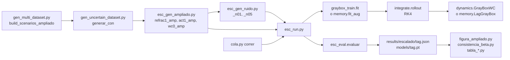

# Especificaciones técnicas del pipeline gray-box

Referencia para responder preguntas técnicas: qué hace cada pieza, con qué parámetros, en qué archivo y función, y cómo se conectan. Todo está en el repo `wilson-cowan-id` (Pedro, rama `main`). Acompaña a [[Avances desde el póster de la Jornada]].

---

## 1. El pipeline de punta a punta



1. **Escenarios.** `scripts/gen_multi_dataset.py` define los estímulos (P, Q) y su rol (entrenamiento, validación o test).
2. **Planta.** `scripts/gen_uncertain_dataset.py` simula Wilson-Cowan más una perturbación y guarda las trayectorias junto con el término omitido verdadero, $\Delta f$.
3. **Ruido.** `scripts/esc_gen_ruido.py` le suma ruido a un dataset ya generado, sin regenerar trayectorias.
4. **Una corrida.** `scripts/esc_run.py` carga el dataset, arma el modelo, entrena, elige la época por validación, evalúa y guarda.
5. **Lotes.** `scripts/cola.py` reparte muchas corridas en lugares fijos.
6. **Análisis.** Los scripts de figuras y tablas leen los JSON de `results/escalado/`.

---

## 2. La planta simulada

### Wilson-Cowan reducido (el backbone)

$$
\dot E = \tfrac{1}{\tau_e}\big[-E + S(a_e u_e) - k_e\big],\quad u_e = w_{EE}E - w_{EI}I + P - \theta_e
$$
$$
\dot I = \tfrac{1}{\tau_i}\big[-I + S(a_i u_i) - k_i\big],\quad u_i = w_{IE}E - w_{II}I + Q - \theta_i
$$

$S$ es la sigmoidea logística, y $k_e = S(-a_e\theta_e)$, $k_i = S(-a_i\theta_i)$ son los offsets que hacen de $E = I = 0$ un equilibrio. Tiempo en ms.

| parámetro | valor verdadero | | parámetro | valor verdadero |
|---|---|---|---|---|
| $w_{EE}$ | 6,4 | | $\tau_e$ | 1,0 ms |
| $w_{EI}$ | 4,8 | | $\tau_i$ | 2,0 ms |
| $w_{IE}$ | 6,0 | | $a_e$ | 1,2 |
| $w_{II}$ | 1,2 | | $a_i$ | 1,0 |
| | | | $\theta_e$ | 2,8 |
| | | | $\theta_i$ | 4,0 |

β son esos diez. Código: `WilsonCowanParams` y `WilsonCowan` en `src/wilson_cowan/model.py`.

### Las perturbaciones (`src/wilson_cowan/uncertainty.py`)

| clase            | qué hace                                                                                      | parámetros             | estado oculto            |
| ---------------- | --------------------------------------------------------------------------------------------- | ---------------------- | ------------------------ |
| `Refractoriness` | multiplica la sigmoidea por $(1 - r\,x)$, el término del WC original de 1972                  | $r = 0{,}10$           | no                       |
| `Actuator`       | a las poblaciones llega $P_{ef} = 3\tanh(P_{lag}/3)$, con $\dot P_{lag} = (P - P_{lag})/\tau$ | $\tau = 1$ ms, sat = 3 | 2 ($P_{lag}$, $Q_{lag}$) |
| `NoPerturbation` | ninguna; es el control `wc0_amp`                                                              |                        | no                       |
| `Adaptation`     | corriente de adaptación $\dot A = (E - A)/\tau_a$ que frena a E                               | $b = 0{,}5$, $\tau_a$  | 1                        |

Las tandas del escalado, del póster y del dataset ampliado usan solo `Refractoriness`, `Actuator` y `NoPerturbation`. `Adaptation` se usó únicamente en la caracterización previa (`scripts/exp_f7_controls.py`, con $\tau_a$ de 1 a 100 ms), para medir cuánto de su término puede capturar una corrección sin memoria: el $R^2$ cae de 0,97 con $\tau_a = 1$ ms a 0,33 con 100 ms. Queda propuesta como planta para la escalera de memoria y como control de la penalización de antigüedad del núcleo. También existen `SynapticDepression`, `HiddenPopulation` y `HeterogeneousSigmoid`, sin usar en las tandas actuales.

### Integración de la planta

Con perturbación, RK4 de paso fijo con 4 subpasos por muestra (`WilsonCowan._simulate_perturbed`), el mismo tipo de integrador que usa el modelo. 200 ms, 4000 muestras, $dt = 0{,}05$ ms, condición inicial $I = E = 0$.

### Los escenarios (`scripts/gen_multi_dataset.py`)

Siete familias de estímulos on/off: escalón (`box`), onda cuadrada (`square`), APRBS, PRBS, theta-gamma, tren de Poisson y chirp. P y Q descorrelacionados (distinta amplitud, frecuencia o semilla). Encendido entre 10 y 190 ms.

| dataset | función | escenarios | entrenamiento / validación / test |
|---|---|---|---|
| original (póster) | `build_scenarios` | 20 | 13 / 0 / 7 |
| ampliado | `build_scenarios_ampliado` | 49 | 28 / 7 / 14 |

El ampliado contiene los 20 originales sin cambios, con el mismo rol. `box_a1.2` lleva la marca `is_extrap`, porque es el único que extrapola en amplitud.

### Archivos de datos (`data/processed/uncertain/*.npz`)

| nombre | planta |
|---|---|
| `refrac1`, `act1` | dataset original |
| `refrac1_amp`, `act1_amp`, `wc0_amp` | dataset ampliado |
| sufijo `_n01`, `_n05` | con ruido σ = 0,01 o 0,05 |

Cada `.npz` trae, por escenario, `I, E, P, Q` (4000 muestras), `dfI, dfE` (el $\Delta f$ verdadero, solo para diagnóstico), `P_eff, Q_eff`, `labels`, `is_test`, `is_val`, `is_extrap`, `dt`, los diez parámetros verdaderos y los metadatos de la perturbación. Los datasets se versionan en el repo.

### $\Delta f$ y el ruido

- **$\Delta f$** = campo de la planta menos campo Wilson-Cowan con β verdadero, evaluado sobre la trayectoria y con el comando comandado (`delta_f_verdadero`, en `gen_uncertain_dataset.py`). Es lo que la corrección tendría que aprender, y solo existe en simulación.
- **Ruido:** gaussiano blanco sobre I y E, semilla 7, sumado al dataset limpio (`agregar_ruido`, en `esc_gen_ruido.py`). La trayectoria y $\Delta f$ quedan exactos. Antes de entrenar se aplica una media móvil de 7 muestras (`suavizar`, en `esc_run.py`, con `--smooth 7`), en entrenamiento y en evaluación.

---

## 3. El modelo

### `GrayBoxWC` (`src/neural_ode/dynamics.py`)

$$
\dot x = f_{WC}(x, P, Q;\beta) + g_\phi(x, \cdot)
$$

- **Parametrización de β.** Los diez parámetros se guardan crudos y pasan por softplus, para que sean positivos. $k_e$ y $k_i$ se recalculan en cada paso a partir de $a$ y $\theta$, para conservar el reposo en $E = I = 0$.
- **`backbone(x, P, Q)`:** el campo Wilson-Cowan, con el término estructurado si está activado.
- **`g_out(x, P, Q)`:** la corrección sola.
- **`forward`:** la suma de los dos.
- **La corrección** es un perceptrón de dos capas ocultas de 32 unidades con tanh. La última capa arranca en cero, así que el modelo empieza siendo el backbone puro.
- **`correction_inputs`** decide qué ve la corrección:
  - `x` = (I, E);
  - `xpq` = (I, E, P, Q);
  - `xhist` = (I, E) más los últimos K valores de P y de Q;
  - `xconv` = lo mismo pasado por el filtro `_FIRMLP`: una capa lineal sin bias de 2K entradas a `n_fir` canales, delante del perceptrón.

### Las variantes (`VARIANTS` en `src/neural_ode/graybox_train.py`)

| nombre en el póster | variante | qué ve o qué agrega | parámetros entrenables |
|---|---|---|---|
| white-box | `whitebox` | sin corrección | 10 |
| agnóstica | `B` | $g(I, E)$ | 1228 |
| historia del comando, 100 | `H --hist 100` | $g(I, E, P_{t..t-99}, Q_{t..t-99})$ | 7628 |
| historia del comando, 400 | `H --hist 400` | 400 muestras = 20 ms | 26 828 |
| filtro entrenable, 4 / 8 / 16 canales | `K --hist 400 --n-fir n` | historia de 400 resumida en n canales | 4556 / 7884 / 14 540 |
| forma exacta | `S` | backbone expandido con $r_i, r_e$ y saturación $\alpha = 1/sat$ | 13 |
| estado de filtro | `lag` (`LagGrayBox`) | backbone expandido con el estado del actuador | 12 |
| latent ODE | `latent` (`LatentGrayBox`) | estado oculto $z$ aprendido | depende |

Otras variantes del código: `A` = $g(I,E,P,Q)$; `C` y `D` = $g(I,E)$ con penalización de norma o de la proyección sobre las direcciones de β; `Sg` = forma exacta más red.

### El estado de filtro (`LagGrayBox`, en `src/neural_ode/memory.py`)

- **Estado aumentado** $y = [I, E, \hat P, \hat Q]$, con $\dot{\hat P} = (P - \hat P)/\hat\tau$ y el backbone recibiendo $\tanh(\alpha\hat P)/\alpha$.
- **$\hat\tau$** se parametriza con softplus y un piso de 0,15 ms. **$\alpha$** va con un clamp en [0,001, 10].
- **`filtered_inputs`** calcula $\hat P$ de forma exacta y diferenciable sobre todo el comando, así cada ventana arranca del valor correcto y no de un transitorio falso.

---

## 4. Entrenamiento

| qué | valor | dónde |
|---|---|---|
| arranque | ignorante, los diez parámetros en 1,0 | `build_model` |
| warm start | β copiado del JSON de un white-box | `cargar_params`, `--init-params` |
| integrador | RK4 de paso fijo, $dt = 0{,}05$ ms, comando constante en el paso | `integrate.rk4_step`, `rollout` |
| esquema | multiple shooting, ventanas de W muestras (100 = 5 ms, 400 = 20 ms) que arrancan del estado observado | `make_windows` |
| pérdida | error cuadrático medio de (I, E) sobre todas las ventanas | `fit` |
| optimizador | Adam, 1500 épocas, recorte del gradiente en 10 | `fit` |
| tasas de aprendizaje | pesos 5e-2, demás parámetros 2e-2, red 3e-3 | `TrainConfig` |
| refinamiento | L-BFGS sobre los parámetros físicos, 60 pasos de 20 iteraciones, búsqueda de línea strong Wolfe | `fit` |
| selección de época | NRMSE de validación cada 100 épocas y tras L-BFGS; se queda con el mejor | `MejorVal` |
| hilos | 1 por corrida en las colas (`WC_THREADS`) | `esc_run.py` |

El estado de filtro y la latent ODE usan `fit_aug` (`memory.py`), con el mismo esquema y sin L-BFGS. Ahí el estado oculto al inicio de cada ventana sale de `filtered_inputs` o de `h0`.

Opciones que se probaron y no quedaron en la tabla principal: `--wd-fir` (penalización L2 sobre el filtro), `--freeze-phys` (β congelado, solo se entrena la corrección), `--lam-norm` y `--lam-orth`.

---

## 5. Evaluación (`scripts/esc_eval.py`)

- **NRMSE de corrida libre** (`nrmse_test`, `_rollout_lote`). Se integran los 200 ms desde el $x(0)$ del dato, con el estímulo como única entrada y sin reanclarse. Por canal es $100 \cdot \text{RMSE} / (\max - \min)$ de la señal real, y se promedia I con E. Se reporta el promedio sobre los escenarios de test (`nrmse_test`), los que interpolan (`nrmse_test_interp`), el de extrapolación (`nrmse_extrap`), la mediana y el valor por escenario (`por_escenario`).
- **Error de parámetros.** $100\,|\hat\beta_k - \beta_k| / \beta_k$, promedio y máximo sobre los diez.
- **$R^2$ de la corrección** (`r2_delta`). Compara la corrección efectiva $\hat g = f_{modelo} - f_{WC}(\hat\beta)$ con $\Delta f$, muestra a muestra sobre la trayectoria real de test:

$$
R^2 = 1 - \frac{\sum \lVert \hat g - \Delta f \rVert^2}{\sum \lVert \Delta f - \overline{\Delta f} \rVert^2}
$$

  `r2_residuo_test` compara, en cambio, contra lo que le falta al backbone con sus propios parámetros, $f_{planta} - f_{WC}(\hat\beta)$.
- **Validación.** El mismo NRMSE, sobre los escenarios de validación (`seleccion(d, "val")`).

---

## 6. Archivos y funciones

### Núcleo (`src/`)

| archivo | funciones y clases |
|---|---|
| `wilson_cowan/model.py` | `WilsonCowanParams`, `WilsonCowan` (`rhs`, `rhs_aug`, `simulate`), generadores de estímulo (`box_pulse`, `square_wave_pulse`, `aprbs_pulse`, `prbs_pulse`, `theta_gamma_pulse`, `poisson_pulse`, `chirp_pulse`) |
| `wilson_cowan/uncertainty.py` | `Perturbation` y sus subclases |
| `data/generate.py` | `generate_dataset`: una trayectoria de la planta |
| `neural_ode/dynamics.py` | `GrayBoxWC`, `_FIRMLP` |
| `neural_ode/memory.py` | `LagGrayBox`, `LatentGrayBox`, `AugTrainConfig`, `fit_aug` |
| `neural_ode/integrate.py` | `rk4_step`, `rollout` |
| `neural_ode/graybox_train.py` | `TrainConfig`, `VARIANTS`, `build_model`, `make_windows`, `apilar_historia`, `fit`, `MejorVal`, `load_split`, `familia_de` |

### Scripts (`scripts/`)

| script | qué hace |
|---|---|
| `gen_multi_dataset.py` | escenarios: `build_scenarios`, `build_scenarios_ampliado`, `EXTRAPOLACION` |
| `gen_uncertain_dataset.py` | `generar_con`: simula todos los escenarios con una perturbación y guarda el `.npz` |
| `esc_gen_datasets.py`, `esc_gen_ampliado.py` | genera `refrac1`/`act1` y `refrac1_amp`/`act1_amp`/`wc0_amp` |
| `esc_gen_ruido.py` | `agregar_ruido` |
| `esc_run.py` | una corrida completa |
| `esc_eval.py` | `evaluar`, `nrmse_test`, `r2_delta`, `seleccion`, `cargar` (rearma un modelo desde su `.pt`) |
| `cola.py` | `correr`: cola con lugares fijos y dependencias |
| `cola_ampliado.py`, `cola_ampliado_wrm.py`, `cola_familias.py` | las tandas e13 y e14 |
| `pausar.py` | congela o reanuda corridas (`--tag`, `--reanudar`) |
| `despierto.py` | impide que Windows suspenda mientras haya corridas |
| `figura_ampliado.py`, `consistencia_beta.py` | figuras y tablas del dataset ampliado y de la consistencia de β |
| `tabla_ruido.py`, `tabla_arranque.py` | tablas con y sin ruido, y del arranque desde el white-box |
| `divergencia.py` | detecta corridas cuya pérdida terminó por encima de su mínimo |
| `diagnostico_fir.py`, `explicar_nucleo.py`, `plot_fir_kernel.py` | análisis del filtro entrenable |
| `snr_real_vs_sim.py` | SNR de los datos reales contra los simulados |
| `train_real_output.py` | ajuste sobre los datos reales de LFP, con estado latente por ventana |

### Experimental (`experimental/lfp/`, por verse)

`observacion.py` (cuatro proxies de LFP), `ruido.py` (ruido $1/f^\chi$), `gen_lfp.py` y `entrenar_lfp.py`: el mismo modelo, ajustado contra una sola señal S.

---

## 7. Cómo se corre

### Una corrida

```bash
python scripts/esc_run.py --data act1_amp_n01 --variant K --hist 400 --n-fir 8 --smooth 7 --init-params results/escalado/e13_e2wb_n01.json --tag e13_K400f8_wrm_n01
```

| opción | qué hace |
|---|---|
| `--data` | nombre del `.npz` en `data/processed/uncertain/` |
| `--variant` | `whitebox`, `A`, `B`, `C`, `D`, `S`, `Sg`, `H`, `K`, `lag`, `latent` |
| `--window` | ventana de multiple shooting en muestras (100 por defecto) |
| `--epochs`, `--lbfgs-steps` | 1500 y 60 por defecto |
| `--hist`, `--n-fir`, `--hidden` | largo de la historia, canales del filtro, ancho de la red |
| `--smooth` | media móvil sobre I y E (7 con ruido, 0 sin ruido) |
| `--init-params` | warm start desde el β de otra corrida |
| `--r-init` | valor inicial de $r$ en la forma exacta (0,05) |
| `--familia` | entrenar y validar con una sola familia de estímulos |
| `--val-every` | épocas entre mediciones de validación |
| `--freeze-phys`, `--wd-fir`, `--lam-norm`, `--lam-orth` | opciones probadas |
| `--seed`, `--tag` | semilla y nombre de la corrida |

### Lo que deja cada corrida

- `results/escalado/<tag>.json`:
  - la configuración;
  - el `data_sha256` del dataset;
  - los minutos que tardó;
  - las métricas de la sección 5;
  - β estimado;
  - la validación: `nrmse_val_mejor`, `ep_mejor_val`, `historia_val`;
  - diagnósticos de la corrección: `g_rms`, `frac_redundante`.
- `results/escalado/models/<tag>.pt`: el checkpoint con los flags de arquitectura.
- `logs/escalado/<tag>.log`: la salida de entrenamiento.

### Lotes

`cola.correr(lista, marca, lugares)` recibe tuplas (tag, argumentos, tag del que depende). Funciona así:
- lanza cada corrida apenas hay lugar;
- espera el JSON de su dependencia, por ejemplo el white-box antes de un warm start;
- saltea las que ya tienen JSON;
- escribe `logs/escalado/<marca>` al terminar.

El número de lugares se puede cambiar en marcha con `logs/escalado/LUGARES`. Las corridas congeladas con `pausar.py --tag` no ocupan lugar y se reanudan antes de lanzar otra.

### Familias de tags

| prefijo | qué es |
|---|---|
| `e1_*`, `e2_*`, `e3_*` | escalado sin ruido: refractariedad, actuador, filtro entrenable |
| `e5_*` | penalización L2 del filtro |
| `e6_*`, `e7_*`, `e8_*` | tandas con ruido del póster y del informe |
| `e9_*` | filtro de 16 canales |
| `e10_*`, `e11_*`, `e12_*` | dos etapas y arranque desde el white-box, dataset original |
| `e13_*` | tabla del póster sobre el dataset ampliado; `_wrm` = warm start, `e1S_cero` = forma exacta desde cero |
| `e14_*` | consistencia de β entre familias (`e14_<planta>_<familia>`) |

Sufijo de ruido: `_n01`, `_n05`; sin sufijo, sin ruido.

---

## 8. Reproducir desde cero

```bash
python scripts/esc_gen_ampliado.py
python scripts/esc_gen_ampliado.py wc0
python scripts/esc_gen_ruido.py act1_amp 0.01 0.05
python scripts/esc_gen_ruido.py refrac1_amp 0.01 0.05
python scripts/esc_gen_ruido.py wc0_amp 0.01 0.05
python scripts/cola_ampliado_wrm.py
python scripts/cola_familias.py
python scripts/figura_ampliado.py
python scripts/consistencia_beta.py
```

Una corrida tarda entre 15 minutos (white-box de una familia) y 4 horas (historia de 400 con ventana de 20 ms), con 3 o 4 corridas a la vez en la máquina actual de 4 núcleos.
